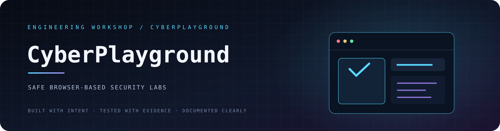
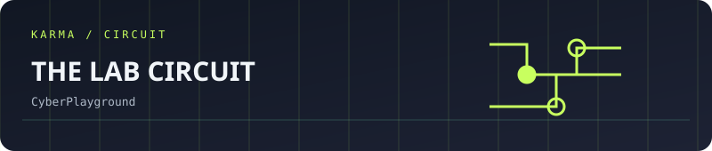
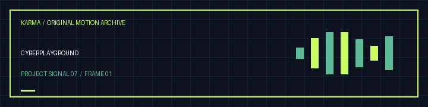

<!-- VISHWAS.EXE UNIFIED THEME START -->
<p align="center"><a href="https://cyber-playground-nu.vercel.app"></a></p>
<p align="center"><strong>VISHWAS.EXE / CyberPlayground</strong><br/>Browser-based security education<br/><sub>Designed and built by <strong>Vishwas Aithal</strong> · Same computer universe, its own personality</sub></p>
<p align="center">
  <a href="https://vishwasaithalz.github.io/vishwasaithalz/"><strong>💾 BOOT MANAGER</strong></a> &nbsp;·&nbsp;
  <a href="https://vishwasaithalz.github.io/vishwasaithalz/overload/"><strong>🖥️ OVERLOAD OS</strong></a> &nbsp;·&nbsp;
  <a href="https://vishwasaithalz.github.io/vishwasaithalz/arcade/"><strong>🎮 ARCADE</strong></a> &nbsp;·&nbsp;
  <a href="https://github.com/vishwasaithalz?tab=repositories"><strong>📁 ALL PROJECTS</strong></a> &nbsp;·&nbsp;
  <a href="https://vishwasaithal.ai.studio/"><strong>🌐 PORTFOLIO</strong></a>
</p>
<!-- VISHWAS.EXE UNIFIED THEME END -->

<details>
<summary><strong>🎞 Open legacy project visuals and original navigation</strong></summary>

<p align="center"><a href="https://cyber-playground-nu.vercel.app"></a></p>
<p align="center"><strong>🎮 CyberPlayground</strong> · Safe interactive security learning</p>
<p align="center">
<a href="https://vishwasaithalz.github.io/vishwasaithalz/arcade/#snake"></a>
<a href="https://karma-ops-monitor.vercel.app"></a>
</p>

<details><summary>🎨 Open original full-size project artwork</summary>
<p align="center"></p>
</details>

</details>

<p align="center">
  <a href="https://github.com/vishwasaithalz/CyberPlayground/actions/workflows/tests.yml"></a>
  
  
  
  
</p>

<p align="center"><strong>A hands-on browser playground for understanding defensive web security concepts.</strong></p>

<p align="center"><a href="#-the-labs">Labs</a> · <a href="#-run-locally">Run locally</a> · <a href="#-safety-model">Safety model</a> · <a href="https://cyber-playground-nu.vercel.app/">Live demo</a> · <a href="#-roadmap">Roadmap</a></p>

## 🧪 The labs

CyberPlayground is a small static site. Each exercise runs locally in your browser and uses example or user-supplied text only.

| Lab | What you learn | Boundary |
|---|---|---|
| HTTP security headers | Recognise common browser security headers | Analyses pasted text only |
| Password entropy concepts | Understand character pools and rough entropy estimates | Never enter a real password |
| Input handling | Compare safe text rendering with unsafe HTML handling | Demonstration does not execute supplied input |\n\nA three-checkpoint beginner learning path connects these labs in sequence. Completion is stored in browser local storage only and can be cleared by removing this site data.

## 🌐 Live demo

[Open CyberPlayground on Vercel](https://cyber-playground-nu.vercel.app/). This production deployment was built from this repository's `main` branch and verified READY on Vercel.

## ⚡ Run locally

No framework, package installation, or build step is required.

```powershell
git clone https://github.com/vishwasaithalz/CyberPlayground.git
cd CyberPlayground
py -m http.server 8000
```

Open [http://localhost:8000](http://localhost:8000).

You can also open `index.html` directly in a modern browser.

## 🧰 Test

Requires Node.js 20 or newer:

```powershell
node --test
```

## 🔐 Safety model

- No target scanning, exploitation, credential collection, or external requests.
- No analytics, telemetry, external APIs, or third-party scripts.
- All calculations and demonstrations run in the browser.
- Do not paste real passwords, tokens, cookies, customer information, or confidential headers.

The exercises teach concepts. They do not certify that a website or application is secure.

## 🗂️ Project structure

```text
index.html          Main learning interface
assets/styles.css   Visual system and responsive layout
assets/app.js       Lab logic
tests/app.test.js   Automated tests
.github/            CI workflow
```

## 🗺️ Roadmap

- [x] Add a guided beginner learning path with local progress.\n- [ ] Add richer, standards-linked explanations for each finding.
- [ ] Add more defensive browser-security exercises.
- [ ] Improve accessibility and keyboard navigation.
- [x] Deploy the GitHub `main` branch to the existing Vercel Cyber Playground project.

## 🤝 Contributing

Suggestions should include the learning objective, safe boundaries, and a reproducible example. See [CONTRIBUTING.md](CONTRIBUTING.md) and [SECURITY.md](SECURITY.md).

<p align="center"><sub>Learn the mechanics. Respect the boundaries. Build safer software.</sub></p>


<!-- KARMA VISUAL IDENTITY: START -->
<div align="center">

**SECURITY EDUCATION / LABS**

 

<sub>Designed for clarity. Built for evidence. No invented status metrics.</sub>

</div>
<!-- KARMA VISUAL IDENTITY: END -->


<!-- KARMA ANIMATED SIGNAL -->
<p align="center"></p>
<details><summary><strong>🎛 Explore the interactive Vishwas Aithal universe</strong></summary><p><a href="https://karma-ops-monitor.vercel.app">Launch the music-enabled Vishwas Aithal homepage</a>. Sound is user-controlled. Motion can be reduced.</p></details>


<!-- KARMA AVATAR GALLERY -->
<p align="center"></p>
<p align="center"><a href="https://karma-ops-monitor.vercel.app/#gallery">Explore the animated project gallery</a></p>


### Original motion gallery



[Download this project's GIF](assets/karma-motion.gif) · [View the animated SVG](assets/karma-signal.svg)


<!-- VISHWAS SIGNATURE SIGNAL START -->
### 🎞 Signature animation / CyberPlayground

<p align="center"><a href="https://vishwasaithalz.github.io/vishwasaithalz/"></a></p>

<p align="center"><strong>Vishwas Aithal / PSYCHKARMA / BOOTDISK 1995</strong><br/>
<a href="https://vishwasaithalz.github.io/vishwasaithalz/">PRESS START / ONE INTERACTIVE PORTFOLIO</a> ·
<a href="https://vishwasaithalz.github.io/vishwasaithalz/arcade/">PLAY ARCADE</a> ·
<a href="https://github.com/vishwasaithalz">GITHUB PROFILE</a></p>

<sub>Original project-specific artwork. This is a visual identity clip, not a live system measurement.</sub>
<!-- VISHWAS SIGNATURE SIGNAL END -->
